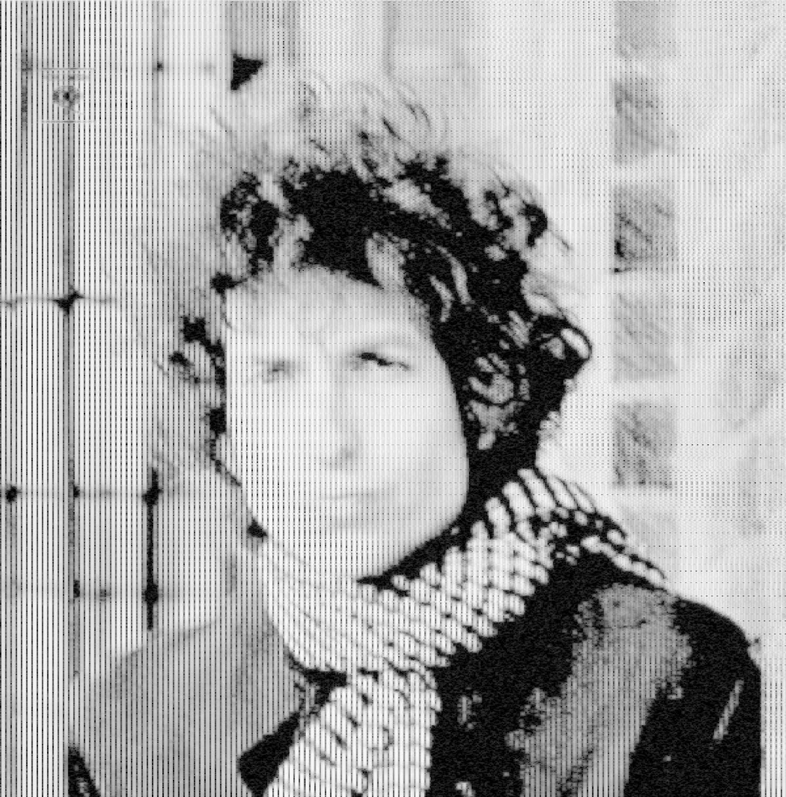

# SpectrumApp

A Windows desktop tool for audio spectrogram visualization, image-to-audio synthesis, and audio-to-image conversion.

## Features

- **Audio → Spectrogram** — Load any audio file (MP3, FLAC, OGG, M4A, WAV, etc.) and view its spectrogram in real time
- **Spectrogram → Audio** — Convert a spectrogram image back into playable audio using phase-locked IFFT synthesis
- **Image ↔ Audio Roundtrip** — Export spectrograms as images and re-import them as audio, with configurable fidelity
- **Frame Selector** — Select a time range and export a cropped spectrogram as PNG
- **Multiple Colormaps** — Viridis, Magma, Inferno, Plasma, Hot, Cool, Ocean, Grayscale
- **Log / Linear Frequency Axis** — Switch between perceptual and linear frequency scales
- **High Resolution FFT** — Up to 8192-point FFT (4096 frequency bins)
- **Zoom & Pan** — Mouse wheel zoom, click-drag pan, scroll bar navigation
- **Drag & Drop** — Drop audio files or images directly onto the window

## Build

Requires [.NET Framework 4.x](https://dotnet.microsoft.com/download/dotnet-framework) and `csc.exe` (ships with Windows).

```powershell
& $env:windir\Microsoft.NET\Framework64\v4.0.30319\csc.exe ^
    /target:winexe /out:spectrum-app.exe ^
    /reference:System.Windows.Forms.dll ^
    /reference:System.Drawing.dll ^
    /reference:System.dll ^
    SpectrumApp.cs
```

Or run the included `编译.ps1` script.

## Dependencies

- **ffmpeg** — required for decoding non-WAV audio formats (MP3, FLAC, OGG, etc.)
  - Place `ffmpeg.exe` in `C:\ffmpeg\bin\` or add it to your `PATH`
  - Download: https://ffmpeg.org/download.html

## Usage

1. **View a spectrogram**: click "导入音频文件", select any audio file
2. **Switch to image mode**: click "加载图片", select a spectrogram image
3. **Generate audio from image**: adjust dynamic range, then click "生成音频"
4. **Export a spectrogram**: click "保存选区", adjust zoom, click "保存图片"

## Tips for Best Image ↔ Audio Roundtrip

| Parameter | Recommended Setting | Reason |
|-----------|-------------------|--------|
| Colormap | Grayscale | Linear 1:1 dB-to-pixel mapping |
| Frequency Scale | Linear | Preserves bin-to-row alignment |
| FFT Window | 8192 | 4096 frequency bins, higher resolution |
| Horizontal Zoom | 1× | No time-axis distortion |
| Vertical Zoom | ~8× (to ~4096px height) | Matches FFT bin count |
| Brightness / Gamma | 1.0 / 1.0 | No nonlinear color warping |

## Gallery

Example spectrograms generated by SpectrumApp (see `examples/` folder):

| Track | Screenshot |
|-------|-----------|
| Dylan |  |
| Dylan (variant) |  |
| Dylan (variant 2) |  |
| Dylan (variant 3) |  |
| Gosh — Jamie xx, MC Moose |  |
| Harder, Better, Faster, Stronger — Daft Punk |  |
| Harder, Better, Faster, Stronger — Daft Punk (z2.0) |  |
| Harder, Better, Faster, Stronger — Daft Punk (z3.0) |  |
| adore u |  |
| when you sleep |  |

## License

MIT
